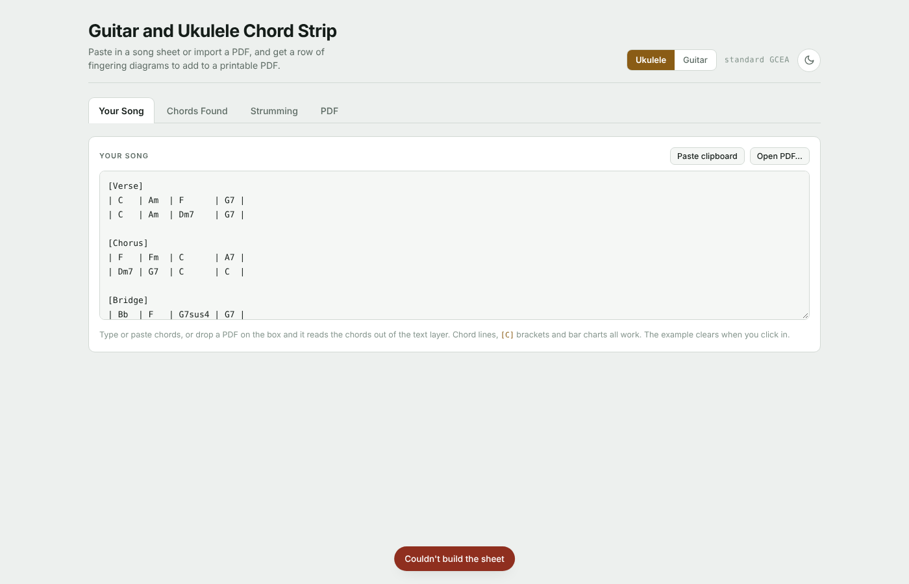
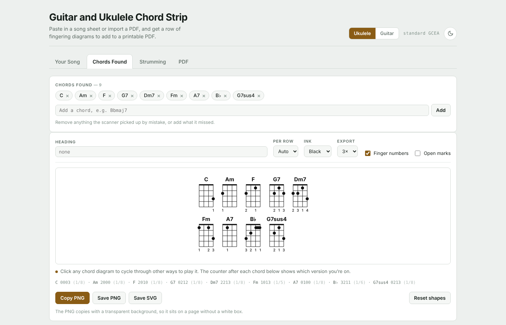
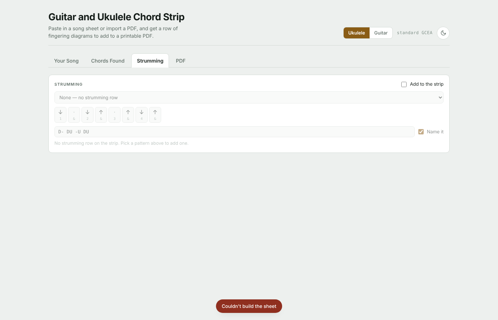
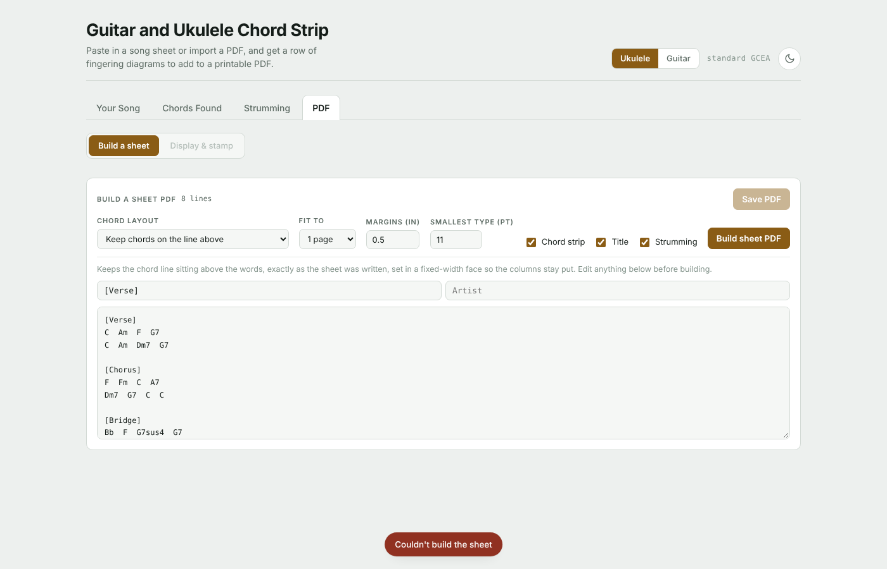
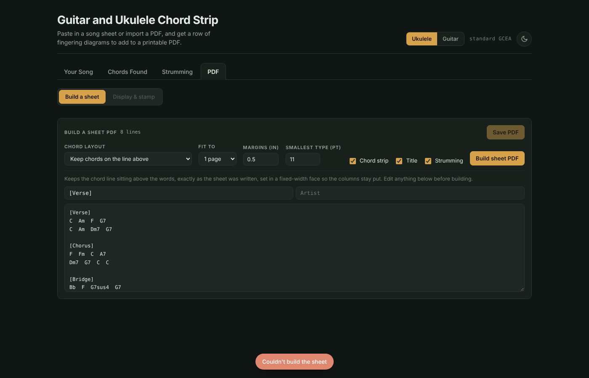

# Guitar and Ukulele Chord Strip - User Manual

A comprehensive guide to using the Guitar and Ukulele Chord Strip application.

## Table of Contents

1. [Getting Started](#getting-started)
2. [Interface Overview](#interface-overview)
3. [The Your Song Tab](#the-your-song-tab)
4. [The Chords Found Tab](#the-chords-found-tab)
5. [The Strumming Tab](#the-strumming-tab)
6. [The PDF Tab](#the-pdf-tab)
7. [Tips & Best Practices](#tips--best-practices)
8. [Troubleshooting](#troubleshooting)

## Getting Started

### What You Need
- A modern web browser (Chrome, Firefox, Safari, or Edge)
- Either a PDF file of sheet music OR plain text lyrics with chord names
- An internet connection (only needed to load fonts)

### Opening the App
1. Open `chord-strip.html` in your web browser
2. The app will load immediately—no installation needed!

### Quick Start Workflow
1. **Paste Song or Upload PDF** → "Your Song" tab
2. **Review Chords** → "Chords Found" tab  
3. **Pick Strumming Pattern** → "Strumming" tab
4. **Stamp to PDF or Build Sheet** → "PDF" tab

---

## Interface Overview

### Header Elements

**Dark/Light Mode Toggle**: Located at the top right of the interface, allows switching between light and dark themes. The app remembers your preference.

**Tab Navigation**: Four main tabs organize the workflow:
- **Your Song**: Input your music
- **Chords Found**: Review extracted chords
- **Strumming**: Select rhythmic patterns
- **PDF**: Create your final output

### General Controls

- **Large Touch-Friendly Buttons**: All buttons are sized for easy clicking on both mouse and touch screens
- **Text Input Fields**: Support copy/paste from any source
- **Preview Areas**: Visual feedback shows changes in real-time

---

## The Your Song Tab



The "Your Song" tab is where you input your music—either as a PDF file or plain text lyrics.

### Input Methods

#### Option 1: Paste Lyrics as Text

1. Click the text field under "Your Song"
2. Paste or type your song lyrics with chord names:
   ```
   Verse 1:
   [G] I wake up in the morning light
   [Dsus4] Ready for a brand new day
   [Asus4] Living for the flowers and the sunshine
   [Em] Oh, yeah
   ```
3. The text field accepts:
   - Chord names anywhere in the text
   - Chords in brackets [C] or standalone notation
   - Any text format (lyrics, lead sheets, tabs, etc.)
4. Click "Analyze Chords" or just navigate to another tab
5. The app automatically extracts and displays found chords

#### Option 2: Upload a PDF

1. Click the "Drop PDF here or click to select" area
2. Choose a PDF file from your computer, OR
3. Drag and drop a PDF onto the box
4. A preview of the first page will appear
5. The app will automatically extract chord names from the PDF

### Extracted Content Preview

After uploading a PDF or pasting text:
- **PDF Preview**: Shows the first page of your sheet music
- **Text Content**: Displays extracted text from the PDF
- **Detected Chords**: A preliminary list appears

### Managing Your Input

- **Clear & Start Over**: Each new song automatically clears previous settings
- **Switch Between PDF and Text**: You can paste text even with a PDF loaded (they work independently)
- **Edit at Any Time**: Modify your input, and the app will re-analyze

---

## The Chords Found Tab



The "Chords Found" tab displays all chord names extracted from your input, with fingering diagrams for each.

### Understanding Chord Diagrams

Each chord diagram shows:

```
    1  2  3  4
    |  |  |  |
    ●  -  -  -    (Chord Name)
    -  ●  -  -
    -  -  ●  -
    -  -  -  ●
```

**Components**:
- **Top Line**: String numbers (1, 2, 3, 4 for ukulele; 1-6 for guitar)
- **Vertical Lines**: Individual strings
- **Dots (●)**: Finger placement
- **Numbers**: Which finger to use (1=index, 2=middle, 3=ring, 4=pinky)
- **Curved Line**: Barre chord indicator
- **'o'**: Open string (play unfretted)
- **'x'**: Muted string (don't play)

### Chord Recognition

The app recognizes:
- **Note Letters**: A, B, C, D, E, F, G
- **Accidentals**: # (sharp) or b (flat)
- **Chord Types**:
  - `m`, `min` → Minor
  - `dim`, `o` → Diminished (°)
  - `aug`, `+` → Augmented
  - `7`, `dom7` → Dominant 7th
  - `maj7`, `M7` → Major 7th
  - `m7` → Minor 7th
  - `sus2`, `sus4` → Suspended
  - `add9`, `add11` → Added notes
  - Plus jazz extensions: 9, 11, 13

**Examples of recognized chords**:
- `C`, `Cm`, `Cmaj7`, `C7`, `Csus4`, `C#m`, `Db9`, `Em7b5`

### Instrument Selection

At the top of the chord list:
- **Select Your Instrument**: Choose between "Ukulele (standard GCEA)" and "Guitar (standard EADGBE)"
- Diagrams update immediately to reflect the chosen instrument
- Selection is saved with your session

### Multiple Voicings

Some chords have alternate fingerings:
- **Primary Voicing**: The most common or easiest fingering
- **Alternate Voicings**: Click "Show alternate" (if available) to see other ways to play the chord
- Useful if an alternate voicing fits better with nearby chords or is easier to play

### Finding Chords

If your desired chord isn't in the list:
1. Check spelling (e.g., "Am" not "A minor")
2. Look for similar chord types (Em7sus4 might show as Em7)
3. If completely missing, the chord might be non-standard or misspelled in your input

---

## The Strumming Tab



The "Strumming" tab provides access to 50+ authentic strumming patterns, each with song examples.

### Browsing Patterns

1. **Scroll Through Patterns**: View all available strumming patterns
2. **Pattern Format**: Each pattern shows:
   - Pattern name (e.g., "Basic Down-Up")
   - Rhythm notation (standard 4/4 eighth-note format)
   - **Examples**: Songs that use this pattern
   - **Feel**: Visual indicator of rhythm character

### Understanding Pattern Notation

```
D   D U U D U
↓   ↓ ↑ ↑ ↓ ↑
1 & 2 & 3 & 4 &
```

- **↓ (D)**: Down stroke
- **↑ (U)**: Up stroke
- **Numbers**: Beat positions (1-4 in 4/4 time)
- **&**: The "and" or off-beat

### Selecting a Pattern

1. **Click any pattern** in the list to select it
2. **Visual Feedback**: Selected pattern highlights
3. **Session Storage**: Your choice is saved during your session

### Using Patterns

The selected strumming pattern is included when:
- Building a PDF with "Build a Sheet" mode
- Creating a new formatted document from text
- Exporting your chord chart

### Pattern Categories

Patterns are organized by feel/rhythm character:
- **Ballad/Slow**: Gentle, sparse patterns for slower songs
- **Pop/Rock**: Standard 4/4 patterns for contemporary music
- **Funk/Soul**: Syncopated, rhythmic patterns
- **Country**: Characteristic country strumming styles
- **Folk**: Traditional acoustic patterns
- **Jazz**: Swing and jazz feel patterns

---

## The PDF Tab



The "PDF" tab has two modes: **Display & Stamp** (for overlaying chords onto PDFs) and **Build a Sheet** (for creating formatted documents from text).

### Display & Stamp Mode

This mode lets you overlay chord diagrams directly onto your PDF sheet music.

#### Navigation

- **Left/Right Arrows**: Large touch-friendly arrows navigate multi-page PDFs
- **Arrow Visibility**: Arrows only appear when there are pages to navigate to
- **Page Counter**: Shows current page (e.g., "Page 1 of 3")

#### Chord Diagram Placement

**Preview Area**:
- Shows your PDF page with the chord diagram overlay
- The chord diagram box is fully interactive

**Positioning**:
1. **Drag to Move**: Click and drag anywhere on the chord diagram to reposition it
2. **Resize**: Click and drag the corner handles to resize the diagram
3. **Handles**: Large, easy-to-click squares in the corners for touch devices
4. **Visual Feedback**: The diagram updates in real-time as you move/resize

#### Per-Page Controls

For each page, you can:

1. **Toggle Chords "On/Off"**: Checkbox "Chords on this page" controls whether chords appear
2. **Apply to All Pages**: Check "Every page on the same settings" to:
   - Apply the same position and size to all pages
   - Note: Position adjusts automatically for each page's content

#### Saving

1. **Position and Size** your chord diagram
2. Click **"Save PDF with Chords"** button (top right)
3. Your browser downloads the stamped PDF
4. The chord diagram is embedded as an image layer

**Note**: The saved PDF is a new file; your original remains unchanged.

---

### Build a Sheet Mode



This mode creates a new, formatted PDF from your text lyrics and chords, with automatic reflowing and optional chord-folding.

#### Creating Your Sheet

1. **From Your Song Tab**: If you pasted text with chords, this data is used automatically
2. **Configure Format**:

#### Reflow Options

Choose how many pages to distribute your content across:
- **1 Page**: Condense everything onto a single page
- **2 Pages**: Split across two pages (most common)
- **3 Pages**: Spread content across three pages for larger text

#### Chord Placement Options

**Chord on Line Above** (Recommended):
```
[G]   [D]   [A]
I wake up in the morning light
Ready for a brand new day
```

**Chord Folded In** (Compact):
```
[G] I wake up in the morning light
[D] Ready for a brand new day
```

#### Page Layout

**Margins** (default: 0.5 inches):
- Apply to top, bottom, left, and right
- Adjustable for different paper sizes
- Affects overall page density

**Headers/Footers**:
- Song title and artist repeat at the bottom of each page
- Page numbers appear on multi-page documents
- Automatically formatted for professional appearance

#### Live Preview

Before saving:
1. All changes in the layout panel update the preview instantly
2. Preview shows exactly what your saved PDF will look like
3. Adjust margins, reflow, or chord style as needed

#### Saving

1. **Preview First**: Review the layout in the preview area
2. Click **"Save PDF"** button
3. Your browser downloads the formatted PDF

#### Useful Workflows

**Scenario 1: PDF Too Long**
- Original PDF is 5 pages
- Use "Build a Sheet" set to 2 pages
- Get a compact, 2-page version

**Scenario 2: Custom Formatting**
- Have plain text lyrics
- Build a professional-looking chord chart
- Choose your preferred chord placement style

---

## Tips & Best Practices

### Input Best Practices

1. **Consistent Chord Naming**: Use standard notation
   - ✅ Good: `C`, `Cm`, `C7`, `Cmaj7`
   - ❌ Avoid: `C major`, `C-minor`, `Cdom`

2. **Clear Formatting**: Chords work best when clearly marked
   - ✅ Good: `[G] My lyrics here` or line before lyrics with chords
   - ✅ Also works: Chords anywhere in text
   - ❌ Avoid: Abbreviations like "B" meaning "B section"

3. **PDF Quality**: PDFs with text layers work best
   - ✅ Good: Digital sheet music PDFs
   - ⚠️ Challenging: Scanned images (limited text extraction)
   - ❌ Avoid: Heavily compressed PDFs

### Positioning Tips

1. **Large Diagrams**: 
   - Drag to center position, then resize larger
   - Helps with visibility on printed sheets

2. **Small Diagrams**:
   - Resize smaller, position in margin
   - Saves space on tight layouts

3. **Multi-Page PDFs**:
   - Set position on page 1
   - Use "Every page" for consistent placement
   - Adjust individually if needed

### Workflow Tips

1. **Multi-Song Sessions**:
   - Load new song (clears old settings)
   - Start fresh for clean results

2. **PDF vs. Text**:
   - PDF + Stamp: Best for existing sheet music
   - Text + Build Sheet: Best for creating custom layouts

3. **Backup Your Work**:
   - Save the generated PDF
   - Export/save your chord list
   - Browser storage persists between sessions

### Accessibility

- **High Contrast**: Dark mode for better readability
- **Large Touch Targets**: All buttons sized for easy interaction
- **Keyboard Navigation**: Tab through controls, Enter to activate
- **Mobile Friendly**: Works on tablets and phones

---

## Troubleshooting

### PDF Won't Upload

**Problem**: "File not supported" or PDF preview blank

**Solutions**:
1. Check file size (very large PDFs may timeout)
2. Verify PDF is not password-protected
3. Try a different PDF file to isolate the issue
4. Check browser console (F12 → Console) for error details

### Chords Not Recognized

**Problem**: Expected chords don't appear in "Chords Found"

**Possible Causes**:
- **Spelling mistakes**: "Cm" vs "C-minor", "F#" vs "F♯"
- **Format issues**: Chords buried in other text
- **PDF limitations**: Text stored as images or outlines

**Solutions**:
1. Verify chord spelling matches standard notation
2. Try typing chords directly in the text field
3. Copy chord names from a reliable source
4. Check if the app detects any chords at all (text might be unreadable)

### Chord Diagrams Look Wrong

**Problem**: Finger positions don't match expected voicing

**Explanation**:
- The app shows correct voicings for standard tuning
- Some chords have multiple valid fingerings
- Check for alternate voicings (available for some chords)

**Solutions**:
- Try an alternate voicing if available
- Verify you have the correct instrument selected
- Look up the chord in a chord chart reference

### PDF Positioning Issues

**Problem**: Chords appear in wrong location or cut off

**Solutions**:
1. **Drag Diagram**: Move it to correct position manually
2. **Check Margins**: Reduce margins if chords are cut off
3. **Resize**: Make diagram smaller if it's too large
4. **Every Page Setting**: Verify it's correctly enabled/disabled

### Print Quality Issues

**Problem**: Downloaded PDF looks blurry or low quality

**Solutions**:
1. Use "Build a Sheet" for text—produces crisp, scalable results
2. For PDFs, ensure original is high quality
3. Adjust margins and sizing before saving
4. Check printer settings (use "Best" or "High" quality)

### Strumming Pattern Not Appearing

**Problem**: Selected pattern not in exported PDF

**Solutions**:
1. Select pattern before saving
2. Ensure you're in "Build a Sheet" mode
3. Check that your text input has chords (pattern works with chords)
4. Refresh page and re-select pattern if needed

### Browser Issues

**Problem**: App won't load or crashes

**Solutions**:
1. **Clear Cache**: Ctrl+Shift+Delete (or Cmd+Shift+Delete on Mac)
2. **Try Different Browser**: Test in Chrome, Firefox, Safari, or Edge
3. **Check Internet**: Fonts need to load from Google Fonts
4. **Disable Extensions**: Some ad blockers interfere with the app
5. **Update Browser**: Ensure you have the latest version

### Storage/Session Issues

**Problem**: Settings/preferences lost after reload

**Explanation**: The app saves your session to browser storage, but:
- Clearing browser cache clears storage
- Private/Incognito windows don't persist storage
- Some browsers limit storage for local files

**Solutions**:
1. Don't clear browser cache mid-session
2. Use regular (non-private) browsing mode
3. Keep the browser tab open during your session
4. Bookmark the page for quick access

---

## Keyboard Shortcuts

While the app is primarily mouse/touch operated, these keyboard shortcuts help:

- **Tab**: Move between form fields
- **Enter**: Activate focused button
- **Escape**: Close dialogs or deselect elements
- **Ctrl+A**: Select all text in input fields
- **Ctrl+C**: Copy chord diagram (if text selected)

---

## Getting Help

### Built-in Help
- Hover over labels for additional information
- Tab names have tooltip descriptions
- Input fields show examples

### Online Resources
- Check GitHub Issues for known problems
- Read the main README for feature details
- Review chord theory resources for chord naming

### Reporting Issues
If you find a bug:
1. Note the specific steps to reproduce
2. Include browser and OS information
3. Check browser console for errors (F12)
4. Open an issue on GitHub with details

---

## FAQ

**Q: Can I use this on mobile?**
A: Yes! The interface is fully responsive. Large touch targets make it easy to use on phones and tablets.

**Q: Is my data saved to a server?**
A: No. Everything happens in your browser. PDFs and text are never uploaded to any server.

**Q: Can I use this offline?**
A: Mostly yes, but Google Fonts require an internet connection. The app will still work, but may use system fonts.

**Q: What if I accidentally close the browser?**
A: Your settings are saved to browser storage. Loading the app again will restore them. PDFs you download are saved to your computer as normal files.

**Q: Can I use this commercially?**
A: Yes! Create chord charts for clients or public use. All dependencies are open-source compatible.

---

**Happy chord charting! 🎸🎵**
